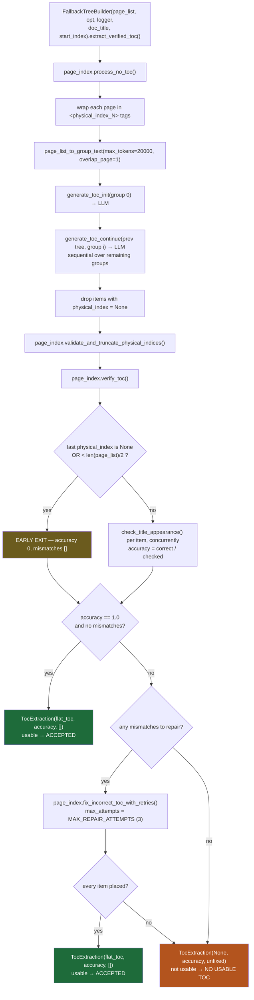
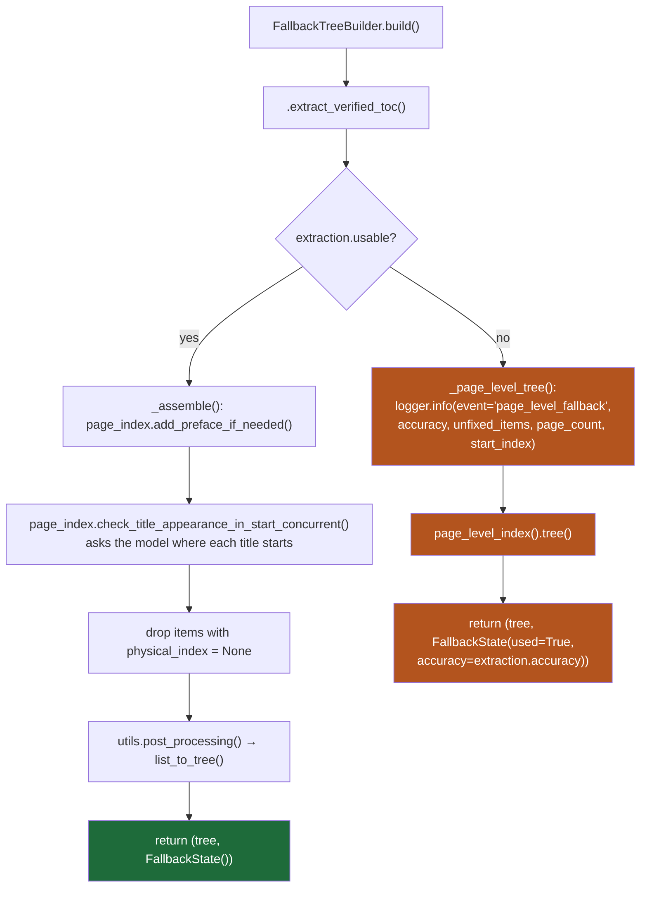
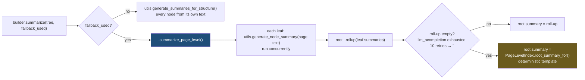
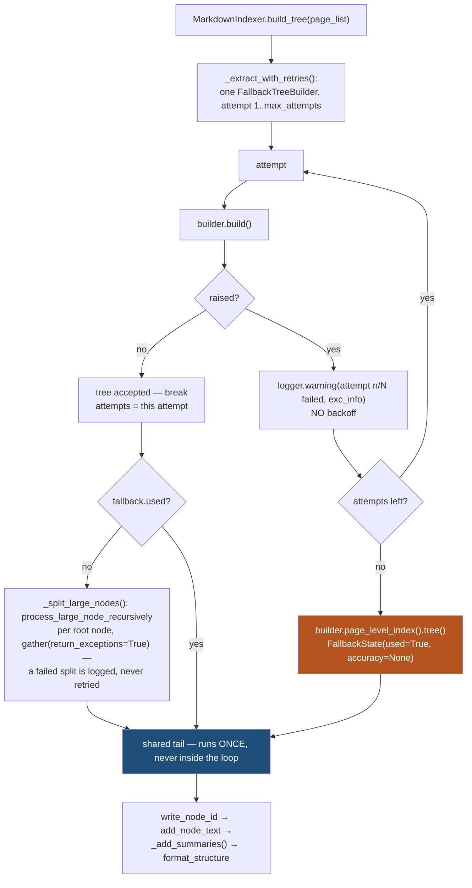

# Page-Level Fallback — Complete Flow

When a document's table of contents cannot be extracted and verified, the pipeline returns
a **page-level index** — one root node plus one leaf per page — instead of failing. This
document traces where that happens and why each step is shaped the way it is.

## The split

`pageindex/` is the **unmodified upstream library**. It knows nothing about the fallback,
and nothing here changes it. Left to itself, `meta_processor()` cascades to weaker
extraction modes and finally raises `Exception('Processing failed')`, so the caller gets
nothing.

`pageindex_fallback/` is a **thin orchestration layer on top of it.** It calls the
library's own building blocks in the same order `meta_processor` does, makes the same
accept decisions, and substitutes the page-level index where the library would have
raised.

```
pageindex_fallback/            one class per module
├── page_level.py     PageLevelIndex          the one-node-per-page structure
│                       .flat_toc()             same shape process_no_toc returns
│                       .tree()                 assembled, root widened — the safe entry
│                       .root_summary_for()     deterministic root text (static)
│                       .widen_root()           root range fixup (static)
├── tree_builder.py   FallbackTreeBuilder     one document: build it, then summarize it
│                       .extract_verified_toc() → TocExtraction
│                       .build()                → (tree, FallbackState)
│                       .page_level_index()     → PageLevelIndex for this document
│                       .summarize()            dispatches on fallback_used
│                       .summarize_page_level() leaves from text, root rolled up
│                       .rollup()               parent from its children's summaries
├── schemas.py        TocExtraction           flat_toc | None, accuracy, unfixed_items
│                     FallbackState           used, accuracy
└── __init__.py       the public surface — re-exports the above

pageindex/            untouched — process_no_toc, verify_toc,
                      fix_incorrect_toc_with_retries, post_processing, …
```

```python
builder = FallbackTreeBuilder(page_list, opt, logger, doc_title="report")
tree, fallback = await builder.build()
await builder.summarize(tree, fallback_used=fallback.used)
```

Two properties hold by construction:

1. **The fallback is unconditional.** There is no `if_page_fallback` switch and no
   `fallback_accuracy_threshold` — neither exists in `config.yaml`, the CLI or the API. A
   TOC is either accepted because it verified clean, or replaced.
2. **No accuracy threshold decides anything.** A score is not evidence that a TOC is
   usable; only a clean verification is.

> **Import note.** `pageindex/__init__.py` does `from .page_index import *`, and
> `page_index.py` defines a *function* named `page_index` — so the package attribute
> `pageindex.page_index` is that function, not the module. `tree_builder.py`
> therefore reaches the modules with `importlib.import_module(...)` and calls
> through them (`page_index.verify_toc(...)`, `utils.llm_acompletion(...)`), which also
> keeps them monkeypatchable from the test harness.

---

## 1. The decision — `FallbackTreeBuilder.extract_verified_toc()`



`TocExtraction.usable` (i.e. `flat_toc is not None`) is the whole signal. The two ways to
come back unusable:

| # | Condition | Typical cause |
|---|---|---|
| 1 | **nothing to repair** — a failing accuracy with an empty mismatch list, which is what `verify_toc`'s early exit returns | the extracted TOC's last `physical_index` is `None`, or covers less than half the document — a truncated or hallucinated extraction |
| 2 | **repair fell short** — `fix_incorrect_toc_with_retries()` still returns misplaced items after its 3 attempts | the LLM invented headings, or placed them where the verifier cannot find them |

**Not** a trigger: an imperfect TOC the repair pass fully fixes. However low the original
score, an empty mismatch list after repair means the TOC is accepted.

---

## 2. Building the tree — `FallbackTreeBuilder.build()`



The `accuracy` reported is the **pre-repair** score — the only one there is, since the
repair pass returns misplaced items rather than a new score.

---

## 3. What the page-level index looks like — `PageLevelIndex`

`PageLevelIndex(page_list, doc_title, start_index).flat_toc()` returns a flat list in the
**same shape `process_no_toc()` returns**, which is the point: everything downstream
handles it unchanged.

```
{structure:'1',   title:doc_title, physical_index:start}
{structure:'1.1', title:'Page 1',  physical_index:1, appear_start:'no'}
{structure:'1.2', title:'Page 2',  physical_index:2, appear_start:'yes'}
{structure:'1.3', title:'Page 3',  physical_index:3, appear_start:'yes'}
...
```

`appear_start` is preset because `post_processing()` derives item *i*'s `end_index` from
item *i+1*:

```
end_index(i)    = next.physical_index - 1   if next.appear_start == 'yes'
                = next.physical_index       otherwise
end_index(last) = end_physical_index
```

* pages `2..N` carry `'yes'` → each preceding page gets a single-page range
* page 1 carries `'no'` → that flag only sets the **root's** `end_index`, keeping it at
  `start_index` instead of `start_index - 1`

`.tree()` then runs `post_processing()` and `.widen_root()`, because `post_processing` can
only give a parent a range reaching its first child's start page — the root would otherwise
span one page.

> **`.tree()` is the only safe entry point.** The preset `appear_start`
> values are exactly what `check_title_appearance_in_start_concurrent()` would overwrite,
> and the upstream library's version has no skip for pre-set values — it would ask the
> model whether the synthetic title `Page 7` appears at the top of page 7 and replace the
> flags with the answers, destroying the single-page ranges. The fallback path never calls
> it, which is asserted by
> `test_the_page_level_path_never_runs_the_boundary_check`.

---

## 4. Summaries — the other half of `FallbackTreeBuilder`



The root spans every page, so `generate_node_summary()` on it would put the whole document
in one prompt. The roll-up prompt scales with the number of children instead. The
deterministic template is the last resort, used only when the LLM returned `''`.

---

## 5. Retry — `MarkdownIndexer` in `api/services/pageindex_service.py`

A failed verification is a *result*, and it is never retried: at `temperature=0` a re-run
reproduces the same extraction. A **raised** failure is different —
`generate_toc_init`/`generate_toc_continue` raise on a truncated completion, and an
unparseable completion makes `extract_json` return `{}`, whose following `extend()` raises
`AttributeError`. Those would otherwise reach the router and become an HTTP 500.



Design points, each deliberate:

* **No backoff between attempts.** `llm_acompletion` has already retried the provider 10×
  with a 1s sleep, so what reaches here is a post-transport failure a pause cannot fix, and
  the endpoint is synchronous.
* **Summaries sit outside the loop**, so a retry never pays for them twice.
* **One builder is reused across attempts.** `FallbackTreeBuilder.build()` stores nothing
  on the instance, so a retried attempt cannot inherit the previous one's state
  (`test_the_builder_can_be_rebuilt_after_a_failure`).
* **Large-node recursion sits outside the loop too.** It re-enters the library's
  `meta_processor` and can raise; re-running the whole extraction to fix one unsplit
  subtree is not worth it, so a failure there is logged and the tree kept as-is.
* **The page-level index is unconditional.** An exhausted retry budget always produces a
  tree.

So the fallback has **two routes**, distinguishable in the response with no extra field:

| Route | Trigger | Built by | `fallback_accuracy` |
|---|---|---|---|
| **failed verification** | the repair pass fell short, or there was nothing to repair | `FallbackTreeBuilder.build()` | the pre-repair accuracy |
| **extraction failure** | every attempt *raised* | `MarkdownIndexer._extract_with_retries()` | `null` — verification never ran |

---

## 6. End to end: the markdown API

```mermaid
sequenceDiagram
    autonumber
    participant C as Client
    participant R as POST /api/v1/pageindex/markdown
    participant S as process_markdown()
    participant B as MarkdownIndexer
    participant O as FallbackTreeBuilder
    participant L as pageindex (unmodified)
    participant S3 as S3

    C->>R: MarkdownPageIndexRequest
    R->>S: process_markdown(payload, s3_session, bucket)
    S->>B: MarkdownIndexer(payload)
    B->>B: config_overrides()<br/>request field &gt; PAGEINDEX_* env &gt; config.yaml
    B->>B: resolve_max_tree_attempts()<br/>request field &gt; env &gt; default 2, clamped 1..3
    S->>S3: read_markdown_from_s3(input_s3_key)
    S->>B: indexer.page_list(content)<br/>&lt;page_number=N&gt; tags → 1 virtual page each,<br/>else tokens_per_page chunking
    S->>B: build_tree(page_list)

    loop attempt 1..max_attempts, until one succeeds
        B->>O: builder.build()
        O->>L: process_no_toc → validate → verify_toc → repair
        alt verified clean, or fully repaired
            L-->>O: usable flat TOC
            O->>L: add_preface → boundary check → post_processing
            O-->>B: tree, FallbackState()
            B->>L: process_large_node_recursively per root node<br/>(gather, return_exceptions=True)
        else no usable TOC
            O->>O: page_level_index().tree() — no LLM, cannot fail
            O-->>B: page-level tree, FallbackState(used, accuracy)
            Note over B: large-node recursion skipped
        else extraction raised
            L--xO: Exception (truncated completion / unparseable JSON)
            O--xB: propagates
            B->>B: logger.warning("attempt n/N failed") — no backoff, retry
        end
    end

    opt every attempt raised
        B->>O: builder.page_level_index().tree()
        B->>B: FallbackState(used=True, accuracy=None)
    end

    B->>L: write_node_id / add_node_text
    B->>B: builder.summarize(tree, fallback_used=…)
    B-->>S: (tree, description, fallback, attempts)
    S->>S3: upload_tree_to_s3(output_s3_key, {doc_description, structure,<br/>fallback_used, fallback_accuracy, attempts})
    S-->>R: + output_s3_key
    R-->>C: MarkdownPageIndexResponse
```

**The PDF/CLI path has no fallback.** `run_pageindex.py` → `page_index_main()` is pure
upstream library, so an unverifiable TOC there still raises `Processing failed`. Wiring
`pageindex_fallback` into that path would mean a wrapper around `page_index_main`.

---

## 7. Configuration

There is **nothing to configure about the fallback.** It always applies. `pageindex/config.yaml`
carries no fallback keys, and because `ConfigLoader._validate_keys()` rejects any key absent
from that file, passing `if_page_fallback` or `fallback_accuracy_threshold` — as a request
field, in `extra_config`, or to `page_index()` — raises `ValueError: Unknown config keys`.

The one knob is the retry budget, and it is a service concern:

```
1. request body: max_tree_attempts   (ge=1, le=3 — out of range is a 422)
2. PAGEINDEX_MAX_TREE_ATTEMPTS
3. default 2, clamped to 1..3
```

It is deliberately **not** part of `opt` — same `_validate_keys()` rule, it would have to
exist in `config.yaml` to travel that way. It resolves in
`MarkdownIndexer.resolve_max_tree_attempts()`.
It affects only *raised* failures: raising it does nothing for a TOC that verifies badly,
and each extra attempt is a full re-extraction.

---

## 8. Observability

| Signal | Where | Meaning |
|---|---|---|
| `logger.info({mode, accuracy, incorrect_results})` | `FallbackTreeBuilder.extract_verified_toc()` | every verification round, whatever the outcome — the record to alert on |
| `event: "page_level_fallback"` | `FallbackTreeBuilder._page_level_tree()` | carries `accuracy`, `unfixed_items`, `page_count`, `start_index` |
| `logger.warning("TOC verification failed (accuracy X%, N unfixed item(s)) — indexing N pages as one node each")` | `FallbackTreeBuilder._page_level_tree()` | human-readable form of the same event |
| `logger.warning("tree extraction attempt n/N failed", exc_info=True)` | `MarkdownIndexer._extract_with_retries()` | one raised attempt; the traceback is the only record of the cause |
| `logger.info("tree extraction succeeded on attempt n/N")` | `MarkdownIndexer._extract_with_retries()` | a retry paid off — the metric that says whether retries earn their cost |
| `logger.warning("all N tree extraction attempts failed … building the page-level index")` | `MarkdownIndexer._extract_with_retries()` | the extraction-failure route fired |
| `logger.warning("large-node splitting failed … keeping it unsplit")` | `MarkdownIndexer._split_large_nodes()` | a subtree did not split; the tree is still returned |
| `fallback_used` / `fallback_accuracy` / `attempts` | API response + S3 JSON | machine-readable outcome |

`accuracy: 0` with an empty `incorrect_results` is the fingerprint of `verify_toc`'s early
exit — the extraction did not cover half the document, so it was never really checked.
`unfixed_items: 0` on the fallback event is the same thing seen from the other side: the
fallback fired without a repair pass because there was nothing to hand it.

---

## 9. Output contract

A page-level tree is **schema-identical** to a normal one — same top-level keys, same
per-node keys, same ordering from
`format_structure(order=['title','node_id','start_index','end_index','summary','text','nodes'])`.
Only the shape differs:

```
normal tree                        page-level tree (N pages)
─────────────────────────          ───────────────────────────────
root                               <doc_title>          [1 .. N]
├─ Section 1     [1..12]           ├─ Page 1            [1 .. 1]
│  ├─ 1.1        [1..5]            ├─ Page 2            [2 .. 2]
│  └─ 1.2        [6..12]           ├─ ...
└─ Section 2     [13..40]          └─ Page N            [N .. N]
   └─ ...
                                   → exactly N + 1 nodes, depth 2
```

Invariants covered by `tests/test_page_level_fallback.py` (the package) and
`tests/test_md_end_to_end.py` (the API route, offline):

* node count `== page_count + 1`; root spans `start_index .. start_index + N - 1`
* every leaf covers exactly one page; ranges are contiguous and gap-free
* absolute page numbers survive a non-1 `start_index`
* the fallback path makes **no** boundary-check LLM call
* a fully repaired TOC is accepted however low its original score was
* `set(normal_keys) == set(fallback_keys)` at both document and node level
* the root summary is the LLM roll-up, not the deterministic template, unless the roll-up
  came back empty
* a retried attempt reports `attempts > 1`; a verification-failure fallback reports
  `attempts == 1`
* the library still raises `Processing failed` on input where the package falls back —
  proof that `pageindex/` is untouched
* passing either removed knob raises `ValueError: Unknown config keys`
